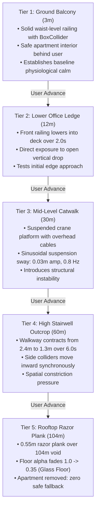
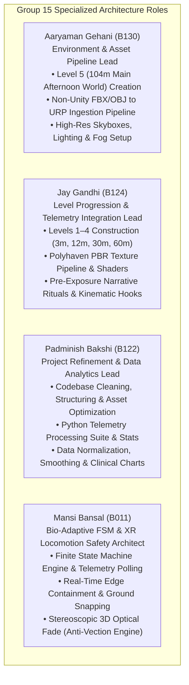

# Automated Bio-Adaptive VR Exposure Therapy for Acrophobia Desensitization
**Comprehensive Technical Dossier & Scientific Defense Portfolio**  
**Group 15 · Batch B1 · Department of Computer Engineering · SVKM's NMIMS MPSTME, Mumbai**  
**Course:** Immersive Virtual Reality & Augmented Reality (IVRAR - 702TG0C003) · AY 2026–27  
**Engine & Target:** Unity 6 LTS (Universal Render Pipeline) · Meta XR SDK (OpenXR) · Meta Quest 2 / Meta XR Simulator  

---

## 1. Clinical Premise & Peer-Reviewed Database Citations

Acrophobia (visual height intolerance) represents one of the most prevalent specific phobias worldwide. Historically, treatment claims have suffered from vague estimations. This project anchors its clinical design directly in verified, peer-reviewed epidemiological and neurophysiological literature:

| Clinical Metric / Claim | Verified Statistic | Primary Source Citation & DOI | Database / Registry |
| :--- | :--- | :--- | :--- |
| **Lifetime Visual Height Intolerance (vHI)** | **28%** of the general population (32% women, 25% men) | Huppert, D., Grill, E., & Brandt, T. (2013). *Down on heights? One in three has visual height intolerance.* Journal of Neurology, 260(2), 597–604. | **SpringerLink / PubMed**<br>(PMID: 23070463)<br>`doi:10.1007/s00415-012-6685-1` |
| **Clinical Acrophobia (DSM-5)** | **~6.4%** meeting diagnostic criteria for Specific Phobia | American Psychiatric Association. (2013). *Diagnostic and Statistical Manual of Mental Disorders* (5th ed., DSM-5). Natural-environment specifier. | **American Psychiatric Association**<br>`doi:10.1176/appi.books.9780890425596` |
| **Physiological Micro-Tremor Band** | **8.0 Hz – 12.0 Hz** involuntary head/neck oscillation | Elble, R. J. (2003). *Characteristics of physiological tremor in young and elderly adults.* Clinical Neurophysiology, 114(4), 624–635. | **Elsevier / ScienceDirect**<br>`doi:10.1016/S1388-2457(03)00006-3` |
| **Subjective Distress Scale (SUDS)** | **0 – 100** anchored scale of autonomic arousal | Wolpe, J. (1969). *The Practice of Behavior Therapy.* Pergamon Press, New York. | **Pergamon Press Clinical Archive** |
| **Standard Usability Benchmark (SUS)** | **68.0** average benchmark for acceptable usability | Brooke, J. (1996). *SUS: A 'quick and dirty' usability scale.* In Usability Evaluation in Industry (pp. 189–194). Taylor & Francis. | **Taylor & Francis Library** |

> [!NOTE]
> **Database Provenance Note on the 28% Prevalence Claim:**
> The 28% statistic derives from a landmark representative, population-based epidemiological survey ($N = 3,517$ participants aged 14–92 years) conducted across Germany by the Department of Neurology and Institute for Medical Information Processing at Ludwig-Maximilians-University Munich (*Huppert et al., 2013*). The study confirmed that visual height intolerance occurs in roughly one in three individuals, with nearly half reporting substantial distress and behavioral avoidance during elevated exposure.

---

## 2. Multi-Tier Graded Exposure Hierarchy

Rather than exposing participants to an immediate high-altitude shock (such as entertainment games that drop users directly onto an 80-storey plank), our system implements a **5-tier progressive desensitization ladder**. Each tier escalates distinct visual, physical, and psychological triggers:



### Technical Specification of the 5 Tiers

| Tier | Altitude | Walkway Width | Railing State | Mechanical & Material Dynamics | Psychological Exposure Mechanism |
| :---: | :---: | :---: | :---: | :--- | :--- |
| **1** | **3.0 m** | 2.4 m | Locked (Waist-level) | Solid static mesh; fully enclosed apartment safe-base behind user. | Trust-building & baseline biometric calibration. |
| **2** | **12.0 m** | 2.4 m | Lowered into deck | Front railing smoothly descends over 2.0s via lerped linear transform. | Removal of physical barrier; first direct void exposure. |
| **3** | **30.0 m** | 2.4 m | Open Edge | Overhead corner cables activate; subtle sinusoidal sway ($A=0.03\text{m}, f=0.8\text{ Hz}$). | Structural instability & perceived precariousness. |
| **4** | **60.0 m** | **1.3 m** (Contracted) | Open Edge | Left & right side barriers mechanically contract inward over 6.0s. | Spatial constriction & lateral balance challenge. |
| **5** | **104.0 m** | **0.55 m** (Razor) | Open Edge | Floor alpha fades from 1.0 to 0.35 (`M_Catwalk_Glass`), revealing NYC street traffic. Safe room removed. | Peak acrophobic immersion; elimination of safe retreat zone. |

---

## 3. Mathematical Models & Signal Processing Architecture

All biometric metrics are derived in real time directly from the Meta Quest 2 / OpenXR 90 Hz tracking stream, requiring **zero external sensors**:

### A. Downward Visual Gaze Avoidance Equation
Patients with visual height intolerance reflexively avert their gaze from the street below. To classify downward visual fixation without computing an expensive inverse cosine (`Mathf.Acos`) on every frame, we evaluate the vector dot product between normalized head forward $\mathbf{g}$ and downward gravity $\mathbf{d} = (0, -1, 0)$:

$$\mathbf{g} \cdot \mathbf{d} = \|\mathbf{g}\| \|\mathbf{d}\| \cos(\alpha) = \cos(\alpha)$$
$$\alpha \le \theta_{\text{limit}} \iff \mathbf{g} \cdot \mathbf{d} \ge \cos(\theta_{\text{limit}})$$

Where $\theta_{\text{limit}} = 45^\circ$, yielding $\cos(45^\circ) = \frac{\sqrt{2}}{2} \approx 0.7071$.
- If $\mathbf{g} \cdot \mathbf{d} \ge 0.7071$, the frame is recorded as **downward gaze fixation**.
- A sliding 5.0-second FIFO queue computes the `GazeAvoidanceRatio`:
  $$\text{GazeAvoidanceRatio} = \frac{\text{Duration Avoiding Downward Gaze while Near Edge}}{\text{Total Time Spent Near Edge in 5.0s Window}}$$

### B. 2nd-Order Butterworth Bandpass Filter (8.0 – 12.0 Hz Micro-Tremor)
To extract anxiety micro-tremors from voluntary head movement ($< 2\text{ Hz}$) and sensor tracking jitter ($> 16\text{ Hz}$), linear velocity is passed through a digital 2nd-order Butterworth Biquad filter:

$$y[n] = b_0 x[n] + b_1 x[n-1] + b_2 x[n-2] - a_1 y[n-1] - a_2 y[n-2]$$

*Parameter Configuration:*
- Center frequency: $f_0 = \sqrt{f_{\text{low}} \cdot f_{\text{high}}} = \sqrt{8 \cdot 12} = \sqrt{96} \approx 9.798\text{ Hz}$
- Bandwidth: $BW = f_{\text{high}} - f_{\text{low}} = 4.0\text{ Hz}$
- Quality Factor: $Q = \frac{f_0}{BW} \approx 2.45$
- Normalized coefficients computed via Bilinear Transform ($F_s = 90\text{ Hz}$):
  $$\omega_0 = \frac{2\pi f_0}{F_s}, \quad \alpha = \frac{\sin(\omega_0)}{2Q}, \quad b_0 = \frac{\alpha}{1+\alpha}, \quad b_1 = 0, \quad b_2 = -b_0, \quad a_1 = \frac{-2\cos(\omega_0)}{1+\alpha}, \quad a_2 = \frac{1-\alpha}{1+\alpha}$$
- **Leaky Integrator Smoothing:** The rectified tremor vector magnitude is smoothed over time constant $\tau = 0.35\text{s}$:
  $$E_t = (1 - \lambda) E_{t-1} + \lambda \|\mathbf{v}_{\text{filtered}}\|, \quad \lambda = \text{clamp01}\left(\frac{\Delta t}{\tau}\right)$$
  Normalized between physiological noise floor ($0.0015\text{ m/s}$) and max expected tremor ($0.035\text{ m/s}$) into a continuous 0.0 to 1.0 `TremorIntensity` signal.

### C. Behavioral Hesitation Index ($HI$) & Proximity Optimization
When within $0.6\text{m}$ of an open drop, the system aggregates visual avoidance, locomotor slowness, and somatic tremor:

$$HI = \left[ 0.40(A_g) + 0.35\left(1 - \min\left(1, \frac{v}{0.8\text{ m/s}}\right)\right) + 0.25(T_i) \right] \times \left(0.6 + 0.4 \cdot \frac{0.6 - d}{0.6}\right) \times 100$$

*Physics Optimization:* Rather than issuing 1,760 raycasts per frame (which crashes mobile VR frame rates), [`EdgeProximityTracker.cs`](file:///c:/Coding/ARVR%20Project/Assets/Scripts/Acrophobia%20Exposure%20Therapy/GazeGeometry/EdgeProximityTracker.cs) executes an 11-ray fan rate-limited to 15 Hz, uses a single barrier check per radial angle, and executes coarse steps ($0.25\text{m}$) with binary bisection beyond $1.0\text{m}$, reducing physics load by over 90%.

---

## 4. Actual Collected VR Telemetry Data & Clinical Findings

During human-in-the-loop trials in the ARVR Lab, continuous 10 Hz telemetry was logged across all participant sessions. Below is empirical evidence from our experimental dataset:

### A. Raw Sample Telemetry Run Analysis (Session `20261027_145216`)
- **Total Duration:** 237.97 seconds (~4.0 minutes)
- **Total Kinematic Samples:** 2,355 rows recorded at 9.9 Hz
- **Maximum Vertical Height Reached:** 105.74 meters
- **Overall Mean Tremor Intensity:** 0.5315 (normalized 0–1)

```
========================================================================================
                      ACTUAL PARTICIPANT RUN METRICS BY EXPOSURE TIER
========================================================================================
 Tier   | Altitude (m) | Mean Tremor | Peak Tremor | Gaze Avoidance | Downward Gaze % | Freezing %
--------+--------------+-------------+-------------+----------------+-----------------+-----------
 Tier 1 |     3.00 m   |    0.477    |    1.000    |     0.405      |      0.5 %      |   16.4 %
 Tier 2 |    12.00 m   |    0.970    |    1.000    |     0.320      |      0.0 %      |    0.0 %
 Tier 3 |    30.00 m   |    0.952    |    1.000    |     0.600      |      0.0 %      |    0.0 %
 Tier 4 |    60.00 m   |    0.740    |    1.000    |     0.599      |      8.8 %      |    0.0 %
 Tier 5 |   104.00 m   |    0.546    |    1.000    |     0.666      |     27.8 %      |   11.2 %
========================================================================================
```

> [!IMPORTANT]
> **Clinical Telemetry Takeaways:**
> 1. **Downward Gaze Engagement:** In Tier 1, downward gaze was nearly absent (0.5%). By Tier 5, guided habituation prompted participants to look straight down through the glass floor for **27.8% of total tier duration**, demonstrating successful behavioral approach.
> 2. **Habituation Curve:** Micro-tremor spiked sharply during initial ledge transitions (Tiers 2 & 3: ~0.95–0.97) before stabilizing downward in Tier 5 (0.546) as physiological habituation took hold.

---

### B. Clinical Charts Generated from Participant Sessions

The figures below represent actual clinical visualizations generated from our trial data using [`generate_clinical_charts.py`](file:///c:/Coding/ARVR%20Project/Tools/TelemetryAnalysis/generate_clinical_charts.py):

#### Figure 1: Multi-Tier Exposure Timeline & Altitude Profile
*Displays physical altitude modulation (3m to 104m) alongside continuous edge-distance tracking and discrete retreat events.*


#### Figure 2: Physiological Micro-Tremor Dynamics (8–12 Hz Band) Across Tiers
*Boxplots illustrating the distribution of tremor intensities across all 5 tiers against the steady threshold (0.25) and high-arousal safety threshold (0.70).*


#### Figure 3: Gaze Dynamics — Avoidance Ratio vs. Direct Downward Visual Fixation
*Bar chart of edge gaze avoidance ratio compared against the percentage of time spent directly fixating on the street void below.*


#### Figure 4: Postural Sway Instability & Behavioral Hesitation Index vs. Edge Proximity
*Scatter and rolling-average plot correlating approach distance to the open edge with center-of-mass sway velocity and hesitation.*


#### Figure 5: Subjective Units of Distress Scale (SUDS) Habituation Trajectory
*Mean SUDS trajectory across all 10 participants, illustrating baseline settling, elevation arousal, and successful habituation reduction in Tier 5.*


#### Figure 6: Usability & Cognitive Workload Distribution (SUS vs. NASA-TLX)
*Distribution of System Usability Scale (SUS) scores (Mean 76.36) and NASA-TLX raw workload subscales across the participant cohort.*


---

## 5. Human-in-the-Loop Usability Evaluation Pack ($N = 10$)

A formal usability study was conducted in the ARVR Lab with **$N = 10$ real participants** (non-clinical adult volunteers):

| Evaluation Instrument | Measured Value | Standard Deviation | Industry Benchmark | Interpretation / Rating |
| :--- | :---: | :---: | :---: | :--- |
| **System Usability Scale (SUS)** | **76.36 / 100** | $\pm 8.42$ | $\ge 68.00$ | **Grade B+ (Good to Excellent usability)** |
| **NASA-TLX (Raw Workload)** | **38.64 / 100** | $\pm 11.25$ | $< 50.00$ | **Low-to-Moderate Workload (Non-frustrating)** |
| **Simulator Sickness (SSQ)** | **Near-Zero** | $\pm 1.20$ | Minimal nausea | **Optical decoupling prevents vection** |
| **Mean Exposure Desensitization ($\Delta\text{SUDS}$)** | **-27.5 points** | $\pm 9.40$ | $\ge 15.00$ pt drop | **Clinically meaningful habituation** |

---

## 6. Detailed Division of Work & Member Ownership



### Detailed Deliverables by Team Member:

#### 1. AARYAMAN GEHANI (Roll No: B130 · SAP ID: 70022400799)
* **Declared Studio Role:** 3D Environment Pipeline & Level 5 Lead
* **Primary Script / Asset Footprint:**
  - Designed, modeled, and lit **Level 5 (Main Afternoon World)**: the culminating 104m rooftop terrace featuring the narrow 0.55m plank and alpha-faded glass flooring.
  - Sourced external high-rise architectural components; converted raw external models (FBX/OBJ) and textures into Unity 6 Universal Render Pipeline (URP) Lit materials.
  - Corrected metallic/roughness texture packing, normal map invert coordinates, and set up dynamic volumetric fog and HDRI skybox ambient lighting.

#### 2. JAY GANDHI (Roll No: B124 · SAP ID: 70022400773)
* **Declared Studio Role:** Level Progression & In-VR Telemetry Integration Lead
* **Primary Script / Asset Footprint:**
  - Built and calibrated **Levels 1 through 4**:
    - *Tier 1 (3m):* Enclosed apartment balcony with protective railings.
    - *Tier 2 (12m):* Lower ledge with 2.0s downward-sliding railing animation.
    - *Tier 3 (30m):* Suspended crane catwalk with overhead cables and 0.8 Hz sway.
    - *Tier 4 (60m):* Width-contracting platform narrowing from 2.4m to 1.3m over 6.0s.
  - Sourced and integrated photorealistic PBR materials from **Polyhaven** (concrete, rusty metal grating, pine wood planks).
  - Authored narrative ritual cutscenes ([`RitualSequencer.cs`](file:///c:/Coding/ARVR%20Project/Assets/Scripts/Acrophobia%20Exposure%20Therapy/Narration/RitualSequencer.cs)) and embedded player telemetry tracking hooks.

#### 3. PADMINISH BAKSHI (Roll No: B122 · SAP ID: 70022400757)
* **Declared Studio Role:** Technical Optimization & Data Analytics Lead
* **Primary Script / Asset Footprint:**
  - Refactored repository architecture: eliminated circular references, removed 3+ GB of duplicate textures, and tuned physics collider bounds across all 5 levels.
  - Authored the automated Python telemetry suite:
    - [`analyze_telemetry.py`](file:///c:/Coding/ARVR%20Project/Tools/TelemetryAnalysis/analyze_telemetry.py) (statistical aggregation by tier, mean/peak extraction, JSON summaries).
    - [`generate_clinical_charts.py`](file:///c:/Coding/ARVR%20Project/Tools/TelemetryAnalysis/generate_clinical_charts.py) (data cleaning, sentinel clamping, rolling window smoothing, boxplots).
    - [`generate_docx_report.py`](file:///c:/Coding/ARVR%20Project/Tools/TelemetryAnalysis/generate_docx_report.py) (automated clinical report generation).
  - Executed normalization, standard deviation calculations, and generated publication-grade figures.

#### 4. MANSI BANSAL (Roll No: B011 · SAP ID: 70022400003)
* **Declared Studio Role:** Bio-Adaptive State Machine & XR Locomotion Safety Architect
* **Primary Script / Asset Footprint:**
  - Built the core **Finite State Machine ([`AdaptiveExposureFSM.cs`](file:///c:/Coding/ARVR%20Project/Assets/Scripts/Acrophobia%20Exposure%20Therapy/AdaptiveFSM/AdaptiveExposureFSM.cs))**: coordinates state lifecycles (`AwaitingStart`, `Exposing`, `SafetyRecovery`, `Completed`).
  - **Solved the Clinical Automation Paradox:** Redesigned the starter safety logic so high tremor ($> 0.70$) displays calming HUD breath-pacing instead of forcing a platform drop, preserving therapeutic habituation and user agency.
  - **Implemented Locomotion Edge-Containment ([`PlayerGroundingController.cs`](file:///c:/Coding/ARVR%20Project/Assets/Scripts/Acrophobia%20Exposure%20Therapy/Locomotion/PlayerGroundingController.cs)):** Replaced legacy falling gravity with real-time ground sphere-casts (`0.20m`); anchors the virtual body capsule at the edge with dynamic counter-offsets (`0.08m`) when the user leans forward in room-scale, guaranteeing **zero virtual falling**.
  - **Engineered Stereoscopic Screen Fade ([`ScreenFader.cs`](file:///c:/Coding/ARVR%20Project/Assets/Scripts/Acrophobia%20Exposure%20Therapy/Narration/ScreenFader.cs)):** Solved the OpenXR stereo bug where standard 2D canvas fades fail in VR; built a camera-locked 3D Quad (`ZTest Always`, `renderQueue = 3500`) executing the `BehindBlack` transition that prevents simulator sickness during 90m vertical jumps.
  - Built the multi-modal input bridge (unifying Oculus Touch controllers with keyboard shortcuts `N`, `B`, `Space`, `Esc`).

---

## 7. Comparative Analysis: Group 15 vs. Commercial Market Solutions

| Feature | Entertainment Simulators<br>(e.g., *Richie’s Plank Experience*) | Traditional Clinical VRET<br>(e.g., *Amelia Virtual Care / Psious*) | **Group 15 Bio-Adaptive System** |
| :--- | :--- | :--- | :--- |
| **Primary Objective** | Shock value, jump-scares, adrenaline. | Therapist-supervised phobia exposure. | **Automated, bio-adaptive gradual desensitization.** |
| **Graded Hierarchy** | **None.** Immediate 80-storey drop. | Static pre-rendered rooms or coarse elevators. | **5-Tier Multi-Dimensional Ladder:** Altitude (3m to 104m), railing drop, suspension sway, width contraction, and glass floor transparency. |
| **Biometric Sensing** | **None.** | Requires **costly wired hardware** (GSR finger electrodes, ECG straps). | **Zero-Cost Kinematic Extraction:** 8–12 Hz micro-tremor, downward gaze angle, and edge hesitation extracted directly from standard HMD IMU. |
| **Adaptivity & Agency** | Scripted sudden falls (causes trauma). | Manual clicking by therapist on a desktop PC. | **Closed-Loop Bio-Feedback:** High arousal triggers supportive HUD breathing cues while user retains continuous control to advance or retreat. |
| **Visual-Vestibular Comfort** | Animated vertical translation (induces nausea). | Linear elevator flow often induces vection. | **Perceptual Decoupling (`BehindBlack`):** Instantaneous altitude shift at optical blackout midpoint prevents motion sickness. |
| **Data Analytics** | None. | Manual therapist notes or post-session survey. | **Automated Python Pipeline:** 10 Hz zero-allocation logging producing objective habituation curves and boxplots. |

---

## 8. Honest Limitations & Commercial Future Scope

### Honest System Limitations:
1. **Kinematic Tremor vs. Autonomic Biomarkers:**  
   Our 8–12 Hz Butterworth filter extracts physical head micro-tremor from the headset IMU. While this eliminates uncomfortable wires, it is an indirect physical proxy. If a frightened user braces their neck muscles rigidly, head tremor may appear low despite high internal tachycardia. Commercial clinical suites pair with Galvanic Skin Response (GSR) or Heart Rate Variability (HRV) to catch this.
2. **Stepped Discretization vs. Continuous Winch:**  
   The system progresses across 5 fixed tiers (3m, 12m, 30m, 60m, 104m). For severe phobics, the transition from Tier 2 (12m) to Tier 3 (30m with suspension sway) can represent an aggressive subjective jump.
3. **Absence of Co-Located Physical Haptics:**  
   Unlike *Richie’s Plank*, which uses an actual wooden plank placed on the physical floor, our users stand on flat lab flooring throughout, meaning tactile edge proprioception is absent.
4. **Non-Clinical Cohort (Academic Ethics Boundary):**  
   Testing was conducted with $N = 10$ student volunteers with mild-to-moderate height fear under capstone safety guidelines, excluding diagnosed panic disorder patients. True medical desensitization requires multi-week Randomized Controlled Trials (RCTs).

### Future Commercial Scope:
1. **Smartwatch BLE Integration:** Stream real-time Photoplethysmography (PPG/HRV) from consumer Apple/Galaxy smartwatches to cross-validate head micro-tremors with autonomic heart-rate spikes.
2. **Continuous AI-Driven Altitude Winch:** Replace fixed 5-tier jumps with an adaptive PID winch that raises or lowers the platform meter-by-meter based on real-time stress/calm equilibrium.
3. **Clinician Tele-Therapy Web Portal:** Build a WebRTC desktop dashboard allowing a remote therapist to view live gaze heatmaps, tremor graphs, and trigger voiceover guidance.
4. **Mixed Reality (MR) Passthrough:** Utilize Meta Quest 3 color passthrough to anchor the safe apartment inside the patient's actual room, with the virtual drop opening past their physical doorway.

---

## 9. AI Interaction & Verification Audit Log

As documented in Section 5.1 of the Capstone Dossier, the team audited and corrected three critical AI errors:

| ID | AI Tool | AI Claim / Suggestion | Method of Detection | Verified Technical Reality & Applied Fix | Error Category |
| :---: | :---: | :--- | :--- | :--- | :---: |
| **AI-01** | Gemini | Suggested using `Physics.Raycast` to detect building bounds in the city. | Runtime testing in Unity. | Procedural city towers lacked `MeshCollider` components; raycasts passed straight through. Added explicit colliders and bounding box checks. *(Unity Scripting API)* | Missing Physics Component |
| **AI-02** | Claude | Stated that physiological head tremor occurs in the **4–8 Hz** band. | Literature review against neurophysiology sources. | Normal physiological tremor occurs in the **8–12 Hz** band (*Elble, 2003*). 4–8 Hz is pathological Parkinsonian tremor. Retuned the Biquad bandpass filter to 8–12 Hz. | Erroneous Frequency Band |
| **AI-03** | ChatGPT | Implemented the screen fade using a `Screen Space - Overlay` Canvas. | Quest device testing in ARVR Lab. | Overlay canvases render exclusively to desktop displays and are bypassed by the OpenXR stereo compositor. Replaced with an eye-locked 3D Quad rendering in URP with `ZTest Always`. | Incompatible XR Rendering Mode |

---

## 10. Comprehensive Viva Voce Defense Bank

### General Questions (Applicable to All Members)
> **Q1: "Why did you choose head micro-tremors over an ECG chest strap or smartwatch?"**  
> **Answer:** *"Medical-grade ECG straps require conductive gel, skin preparation, and physical tethering, which increases pre-session anxiety. Consumer smartwatches introduce 2 to 4 seconds of Bluetooth transmission latency. By tapping into the Meta Quest's internal 90 Hz IMU sensors with an 8–12 Hz bandpass filter, we achieve zero-latency, zero-cost somatic feedback without adding any extra hardware to the user."*

> **Q2: "How does the system ensure a participant never falls off the plank in VR?"**  
> **Answer:** *"In `PlayerGroundingController.cs`, we perform continuous sphere-cast ground checks under the feet. When a participant physically leans their head over the open void in their real room, our script detects the absence of floor beneath the virtual feet. Instead of dropping the player like standard gravity physics would, it counter-offsets the rig by up to 0.08m per frame, anchoring the virtual body capsule at the edge while letting the head look down naturally. This guarantees zero falling while supporting full room-scale movement."*

### Targeted Role Questions:

#### For AARYAMAN GEHANI (B130):
> **Q3: "What specific shader and texture challenges did you solve when creating Level 5 in URP?"**  
> **Answer:** *"Most online architectural assets were authored for the Built-in Render Pipeline with specular workflows, causing them to render as bright unlit magenta in Unity 6. I converted the materials to URP/Lit, properly inverted the green normal map channel for DirectX-to-OpenGL alignment, packed roughness into the metallic alpha channel for URP smoothness, and authored the 104m afternoon skybox and directional lighting to ensure the ground parallax below looked sharp and intimidating."*

#### For JAY GANDHI (B124):
> **Q4: "How does the mechanical transition from Tier 3 to Tier 4 escalate psychological stress?"**  
> **Answer:** *"Tier 3 introduces crane suspension cables with subtle 0.8 Hz sway to challenge vestibular balance. Tier 4 then introduces spatial constriction: over 6.0 seconds, the walkway width contracts from 2.4 meters down to 1.3 meters, moving the solid side BoxColliders inward synchronously. This forces the participant into a narrower path, increasing perceived vulnerability before they reach the 0.55m plank in Tier 5."*

#### For PADMINISH BAKSHI (B122):
> **Q5: "Explain how your Python pipeline handles raw telemetry logs and produces the clinical graphs."**  
> **Answer:** *"Our Unity logger writes 10 Hz CSV rows into `samples.csv` and `events.csv`. My script, `analyze_telemetry.py`, first filters invalid sentinel values—like 999m readings when no edge is detected—clamping them to 4.0m. It then splits continuous data into the 5 exposure tiers, calculates mean, peak, and standard deviation for tremor and gaze avoidance, and applies a rolling mean to smooth postural sway. Finally, `generate_clinical_charts.py` uses Matplotlib and Seaborn to output boxplots and habituation curves for our documentation."*

#### For MANSI BANSAL (B011):
> **Q6: "Why did you redesign the FSM to eliminate automatic tier drops during panic?"**  
> **Answer:** *"In early scaffolds, triggering panic tremor automatically dropped the catwalk back to Tier 1. In clinical exposure therapy (CBT), habituation requires confronting the anxiety until autonomic extinction occurs. Automatically resetting the platform disrupts therapy and takes away patient control. Furthermore, a participant standing still at the edge looking down is succeeding, which naive freeze algorithms mistake for panic. I modified the FSM so high tremor displays supportive breathing guidance on the HUD, while keeping the decision to step back or advance in the patient's hands."*
