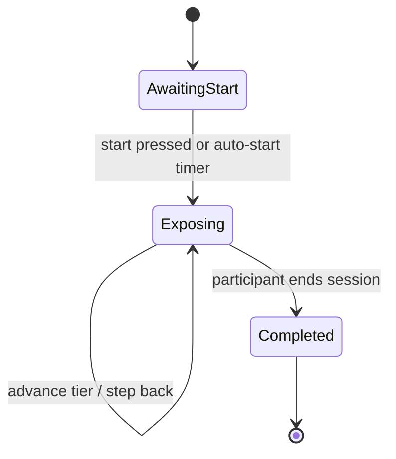

# Acrophobia-Trainer

**A bio-adaptive VR height-exposure prototype for Meta Quest, built in Unity.**

The system places a participant on a five-tier exposure hierarchy, watches how their body responds (head tremor, gaze behaviour, hesitation, postural freezing), gives live feedback and offers support when arousal is high, and records everything for later analysis. The participant stays in control of progression: they advance, step back or end the session whenever they choose.

> Research question (Aalborg-authorised title): *How can an automated bio-adaptive VR exposure therapy system dynamically modulate vertical environmental height based on real-time gaze avoidance and head tremor telemetry to facilitate gradual acrophobia desensitization?*

> **Not a medical device.** This is a student research prototype and a usability study, not therapy. It was evaluated with adult, non-clinical volunteers only. It is not intended for people with a diagnosed phobia, anxiety disorder, epilepsy or vertigo. Anyone can stop at any time.

---

## Contents

- [How it works](#how-it-works)
- [Exposure tiers](#exposure-tiers)
- [Controls](#controls)
- [Getting started](#getting-started)
- [Telemetry](#telemetry)
- [Exporting and analysing data](#exporting-and-analysing-data)
- [Unity Editor tools](#unity-editor-tools)
- [Repository layout](#repository-layout)
- [Ethics and data handling](#ethics-and-data-handling)
- [Known limitations](#known-limitations)
- [Team and context](#team-and-context)
- [References](#references)

---

## How it works

`AdaptiveExposureFSM` is the core state machine. Each frame it polls the signal-processing components, classifies the participant as *steady* or *hesitating*, updates the on-screen status, and reacts to high arousal.

| Signal | Source component | Meaning |
|---|---|---|
| Tremor intensity (0–1) | `TremorBandFilter` | Micro-tremor energy in the 8–12 Hz physiological tremor band |
| Hesitation index (0–100) | `EdgeProximityTracker` | Edge proximity, movement speed and gaze avoidance combined |
| Postural freezing | `PosturalSwayAnalyzer` | Acute postural immobility |
| Gaze avoidance ratio | `GazeAvoidanceDetector` | How much of the time the participant is *not* looking down at the drop |



Inside `Exposing`:

- **STEADY**: tremor < `0.25` and hesitation < `35` (defaults, tunable in the Inspector).
- **TAKE YOUR TIME**: either threshold is exceeded.
- **HIGH AROUSAL**: tremor > `0.70`. The HUD offers a breathing prompt and reminds the participant they can step back or end the session. **Nothing changes automatically.**

**Design decision.** Early versions auto-reverted to Tier 1 on high arousal and could auto-advance on a calm timer. Both were removed: an unrequested change to the height hierarchy is itself a stressor, and a participant standing still at an edge looking down is succeeding, which a freeze detector cannot distinguish from fear. Telemetry therefore informs *feedback and support*; progression is always the participant's choice.

The downward-gaze test is a dot-product comparison, avoiding a per-frame arccos:

```
downward  ⇔  dot(gaze, down) > cos(θ_limit)
```

## Exposure tiers

Five tiers, handled by `DynamicCatwalkController` and `EnvironmentSceneLoader`:

| Tier | Name |
|---|---|
| 1 | Enclosed ledge |
| 2 | Open edge |
| 3 | Crane suspension |
| 4 | Width contraction |
| 5 | Razor plank & glass floor |

Reaching Tier 5 does not end the session; the participant can stay, step back down, or end.

<!-- TODO: add height above ground (m) for each tier once finalised in the build. -->

## Controls

| Action | Quest controller | Keyboard (Editor / XR Simulator) |
|---|---|---|
| Advance one tier | **A** | `↑` |
| Step back one tier | **B** | `↓` |
| End session | **Start** | `Esc` |

The session also starts automatically about one second after launch, so the opening sequence cannot get stuck behind a missing key press in the simulator. Step-back and end are reachable in every exposure state.

## Getting started

**Requirements**

- Unity **6000.5.4f1** with the Android Build Support module
- Meta Quest 2 (or newer), or the Unity XR Simulator for desktop testing
- [Git LFS](https://git-lfs.com/): run `git lfs install` before cloning
- Python 3.9+ with `pandas` and `matplotlib` for the analysis script

**Run in the Editor**

1. `git lfs install`, then clone the repository.
2. Open the project in Unity 6000.5.4f1 and let it import.
3. Open the main scene, press **Play** (the XR Simulator works without a headset).

**Build for Quest**

1. *File → Build Profiles →* switch the platform to **Android** (the first switch re-imports textures and can take a long time; do not interrupt it).
2. Enable the Meta/OpenXR provider and set texture compression to ASTC.
3. Build and install the `.apk` with `adb install`, or use the Release build linked from the repository's Releases page.

<!-- TODO: link the group-15-v1.0 Release once published. -->

## Telemetry

Data is recorded at a configurable fixed rate (default **10 Hz**, up to **72 Hz**) with no garbage collection in the hot path. Tremor is computed from the full-rate head pose stream; only the logged value is down-sampled.

| Group | Channels |
|---|---|
| Head tracking | `head_x/y/z`, `height_above_ground_m`, `head_linear_vel_mps`, `head_accel_mps2`, `head_ang_vel_degps`, `head_pitch_deg` |
| Bio-adaptive | `tremor_intensity` (8–12 Hz), `gaze_avoidance_ratio`, `downward_gaze_cumulative_s`, `sway_velocity_mps`, `com_wander_m`, `is_postural_frozen`, `distance_to_edge_m`, `is_near_edge`, `hesitation_index` |
| Controllers | Left/right position and velocity, trigger and grip axes (0–1), thumbstick vectors, A/X and B/Y buttons |
| Device | `fps`, `battery_pct`, `is_user_present`, `tracking_valid` |
| Events | SUDS ratings (**0–10**) with timestamps, tier transitions, edge-retreat events |

## Exporting and analysing data

Each session writes three files to `Application.persistentDataPath/TelemetryExports/`:

| File | Contents |
|---|---|
| `session_<ID>_samples.csv` | Dense, synchronised multi-channel time series (Pandas / NumPy / R / SPSS ready) |
| `session_<ID>_events.csv` | Timestamped discrete events: SUDS ratings, tier changes, retreats |
| `session_<ID>_summary.json` | Participant metadata, hardware info, dwell time per tier, peak/mean tremor, initial-vs-final SUDS delta (`ΔSUDS = SUDS_start − SUDS_end`) |

Participant IDs are anonymous (`P01`, `P02`, …). Run the analysis script on any session:

```bash
python Tools/TelemetryAnalysis/analyze_telemetry.py \
    --samples "path/to/session_<ID>_samples.csv" \
    --output  "AnalysisResults"
```

It produces a per-tier metrics table, `clinical_metrics_summary.json`, and tremor-vs-tier plots.

## Unity Editor tools

**Tools → Acrophobia → Telemetry & Export Manager**

- **Session Browser**: recorded sessions, sample counts, SUDS progression
- **Open Folder**: jump to the telemetry directory
- **Export Bundles**: copy all CSV/JSON files to a target folder
- **Quest ADB Bridge**: `adb pull` telemetry from a USB- or AirLink-connected headset
- **Python Pipeline Runner**: run the analysis script from inside Unity

## Repository layout

```
Acrophobia-Trainer/
├── Assets/                    Unity scenes, scripts, environments, audio
├── Packages/                  Unity package manifest
├── ProjectSettings/           Unity project settings
├── Tools/TelemetryAnalysis/   Python analysis pipeline
├── HANDOVER.md                Developer handover notes and known traps
├── ROLLBACK.md                Recovery notes
├── push_batches.ps1           Helper for pushing large histories in slices
└── LICENSE
```

## Ethics and data handling

- Participants are adult volunteers who give written consent and can stop at any time.
- Screening excludes anyone with a diagnosed phobia, anxiety disorder, epilepsy or vertigo.
- Session data uses anonymous IDs only: no names, phone numbers or emails in any file.
- Simulator-sickness (SSQ) and distress ratings are monitored; a session stops if either rises.
- Signed consent forms are held by the team and are **not** committed to this repository.

## Known limitations

- Head tremor is estimated from headset pose, not a dedicated IMU. The 8–12 Hz band comes from physiological-tremor literature measured at the hand and fingers, so applying it to head motion is an assumption.
- Sampling must stay above 24 Hz internally to resolve 8–12 Hz (Nyquist); the 10 Hz logging default applies only to what is written to disk.
- The system is a usability prototype. Efficacy for desensitization has not been tested.
- Thresholds (`0.25`, `35`, `0.70`) are hand-tuned defaults, not clinically validated cut-offs.

## Team and context

Built for **Immersive Virtual Reality & Augmented Reality (IVRAR 702TG0C003)**, SVKM's NMIMS Mukesh Patel School of Technology Management & Engineering, Mumbai, AY 2026-27, guided by Dr. Sunny Nanade. This is **Group 15**.

| Member | Role |
|---|---|
| Mansi Bansal | Bio-Adaptive State Machine Lead |
| Padminish Bakshi | XR Systems Architect |
| Jay Gandhi | Gaze & Head Tremor Telemetry Specialist |
| Aaryaman Gehani | Human Factors & Usability Lead |

Forked from [Nightfury129/Acrophobia-Trainer](https://github.com/Nightfury129/Acrophobia-Trainer).

## References

- Huppert D., Grill E., Brandt T. (2013). Down on heights? One in three has visual height intolerance. *J Neurol* 260(2), 597–604. doi:10.1007/s00415-012-6685-1
- Elble R.J. (2003). Characteristics of physiologic tremor in young and elderly adults. *Clin Neurophysiol* 114(4), 624–635. doi:10.1016/S1388-2457(03)00006-3
- Wolpe J. (1969). *The Practice of Behavior Therapy*. Pergamon Press.
- American Psychiatric Association (2013). *DSM-5*. doi:10.1176/appi.books.9780890425596

## License

See [LICENSE](LICENSE).
